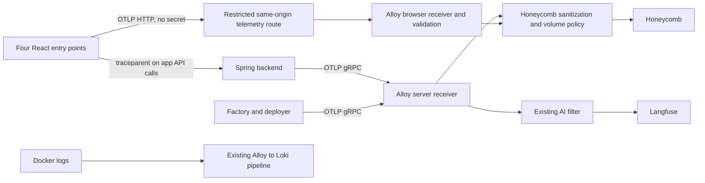

# Honeycomb integration proposal

Research date: 19 October 2026. Status: backend collector pilot implemented,
with deployment pending review. The Free US team `simonrowe.dev` is created.
Browser, factory and async propagation below remain follow-up work. See the
[operating runbook](runbooks/honeycomb-observability.md) for current behavior.

Confirmed constraint: **Honeycomb Free only, with no paid upgrade path.** Scope,
sampling and export volume must fit that allowance.

Use Honeycomb for distributed application traces, retaining Alloy as the collector,
Langfuse for AI content/evaluations, and Loki for container logs. Start with existing
backend spans, then connect the browser and asynchronous work. The first useful
result should be a request waterfall with enough context to explain a failure or
slow response by product, operation, and release.

## What exists today

| Area | Repository evidence | Consequence |
|---|---|---|
| Backend | [Dependencies](../backend/build.gradle.kts) include OTel Spring Boot starter, Micrometer OTel bridge, and Boot's tracing auto-configuration module. [Versions](../gradle/libs.versions.toml): Boot 4.1.1, OTel instrumentation 2.30.0. | Reuse the current instrumentation; do not introduce another SDK/provider or the Java agent. |
| Export | [Production compose](../docker-compose.prod.yml) sets `OTEL_SERVICE_NAME=simonrowe-backend`, OTLP gRPC to `alloy:4317`, metrics/log exporters disabled. [Application config](../backend/src/main/resources/application.yml) also configures the Micrometer tracing exporter and sampling probability 1.0. | Verify that both instrumentation paths share context, resource identity, and sampling and do not double-export spans. The Micrometer sampling property alone does not prove the OTel starter's sampling behavior. |
| Collector | [Production Alloy](../config/alloy/config.alloy) receives gRPC, batches, then filters for AI/chat-turn spans into Langfuse. Tempo is commented out following a wrong-region endpoint failure. | General HTTP/database/custom spans have no retained destination in this configuration. Branch to Honeycomb **before** the AI filter. |
| AI | [ChatTurnTracer](../backend/src/main/java/com/simonrowe/chat/ChatTurnTracer.java), [content filter](../backend/src/main/java/com/simonrowe/observability/LangfuseContentObservationFilter.java), and score client provide sessions, content, and scores. Content capture defaults on; selected CoParent/Meals model calls suppress it. | A blind fan-out would send prompts, completions and tool arguments to Honeycomb. Give Honeycomb a separate sanitization path; preserve Langfuse behavior. Scores submitted through its HTTP API are not automatically span attributes. |
| Frontend | [Dependencies](../frontend/package.json) contain GA4 but no OTel/browser tracing SDK. [Vite config](../frontend/vite.config.ts) builds four entries: main (including admin), school, coparent, meals. API calls use fetch and Axios. | Add a shared telemetry initializer to all four entries; GA4 does not provide browser-to-backend traces. Some architecture comments still say three entries. |
| Chat transport | [chatService.ts](../frontend/src/services/chatService.ts) publishes STOMP messages without trace headers; backend chat uses Reactor observations. | Fetch/XHR instrumentation alone will not connect individual WebSocket chat turns. |
| Background work | Kafka publishers/consumers, schedulers, explicit thread pools and virtual-thread executors. No explicit Kafka observation enablement found in application configuration. | Treat propagation as unverified. Test each execution boundary instead of assuming HTTP instrumentation covers it. |
| Factory/deployer | [Factory dependencies](../software-factory/build.gradle.kts) include Actuator and Temporal, but no explicit tracing starter/bridge. The same image runs as two services. | Add application tracing and Temporal propagation separately, with distinct service identities. |
| Logs/metrics | Alloy ships selected Docker logs to Loki; backend exposes Prometheus on its separate management port. | Keep these paths. Exposing metrics is not evidence of a working remote scrape pipeline; that requires a separate audit. |
| Local development | [Local Alloy](../config/alloy/config.local.alloy) exports AI spans only to local Langfuse; compose publishes 4317. | Keep cloud export opt-in and use a separate Honeycomb development environment. |

The [constitution](constitution.md), principle IV, specifically names Tempo as the
trace destination. Amend that requirement with rationale before implementing a
Honeycomb replacement. Retain its OTel Spring Boot starter, no-Java-agent, Alloy,
and separate management-port requirements. The backend pilot amends that destination to Honeycomb Free.

## Proposed flow



Keep browser ingestion separate from trusted server ingestion so browser-supplied
resource attributes cannot route events into the Langfuse branch. Set trusted
environment/service identity at the ingestion boundary. Keep collector ports on
the internal network; expose only the intended telemetry HTTP path through nginx.

Honeycomb supports standard OTLP; credentials belong in Alloy's server-side env.
Use a region-matched endpoint and ingest key for the selected environment. For
OTLP/HTTP, the Alloy exporter takes the base endpoint and appends `/v1/traces`.
Do not copy a fully suffixed SDK trace endpoint into that base field. See
[Honeycomb OTLP](https://docs.honeycomb.io/send-data/opentelemetry/collector/).

Use stable service names for backend, main browser, school browser, coparent
browser, meals browser, factory, and deployer. Put all production services in one
Honeycomb environment for connected traces; isolate development with its own key.
Backend domains remain attributes, not pretend independently deployed services.

## What to put on spans

A span represents an operation with a start/end, outcome, and useful context.
Prefer enriching an existing request/job/model span over adding a span for every
method or every field. Create child spans for meaningful timed work: retrieval,
queue publication/consumption, synthesis, external calls, or an activity attempt.

| Context | Proposed fields | Questions enabled |
|---|---|---|
| All services | `service.name`, `service.version` (commit SHA), `deployment.environment.name` | Did this release change latency or errors? |
| Product/operation | `app.module` (`site`, `admin`, `school`, `coparent`, `meals`, `factory`), `app.operation`, `app.outcome` | Which feature is failing, including failures returned inside HTTP 200? |
| HTTP | Standard method, normalized route template, status, error type | Which endpoint is slow? Avoid raw paths containing private IDs/query data. |
| Search/retrieval | Result count, cache hit, retrieval duration, source type | Is latency caused by a cache miss or retrieval? No raw search query. |
| AI turn/model | Model/provider, input/output token counts, time to first token, tool count, guardrail verdict | Is a turn slow because of retrieval, model generation, or tools? |
| Narration/summary | Operation/job ID, content type, cache hit, character/chunk count, queue wait, retry attempt | Is a job stuck waiting, repeatedly retrying, or processing slowly? |
| Factory | Workflow/run ID, activity type, task queue, attempt, phase, PR number, commit SHA, result | Where did review/deployment stop, and which attempt failed? |
| Browser | App, normalized page route, release, API operation, controlled error code, action duration | Is the delay in the browser/network or backend? |

These custom names are a proposed schema, not a claim that instrumentation already
emits them. Prefer existing OTel semantic-convention fields where available and
map observed Spring AI keys deliberately; don't create competing token/model fields.
Keep stable names and types across services. Add queryable app/module context to
the relevant child spans too, through explicit context propagation or instrumentation
conventions; parent attributes are not automatically copied to children.

High-cardinality IDs are useful for finding one trace/job and comparing cohorts.
Keep them in trace attributes (Micrometer high-cardinality key values), not metric
labels. Begin without user/family identifiers; only add pseudonymous identifiers
when a specific debugging question warrants them. Never accept identity/tenant
attributes from the browser as authoritative. No arbitrary baggage passthrough.

The Honeycomb branch should allowlist useful attributes and sanitize span names,
status descriptions, exception events, and URLs as well. Exclude prompt/completion
text, tool arguments/results, auth/cookies, request/response bodies, document text,
emails, private family content, raw query strings, and database statement contents.
An exception message can contain any of these too. Bound string/array lengths and
attribute counts at production, then enforce the policy again before export.
Test the complete encoded payload, not just selected span attributes.

Start with a few dozen useful fields. More fields on one span do not mean one
billable event per field, but extra spans and converted span events affect volume.
Honeycomb's ingestion limits are not an instrumentation target; large blobs make
telemetry expensive to transmit and hard to use. See
[event counting](https://docs.honeycomb.io/get-started/manage-costs/how-honeycomb-calculates-usage).

## Delivery sequence and acceptance criteria

| Increment | Work and likely touchpoints | Done when |
|---|---|---|
| 1. Backend pilot | Amend constitution destination wording; add sanitized Honeycomb branch to `config/alloy/config.alloy`, explicit endpoint/key configuration in `.env.example` and deployment wiring; opt-in local config; resource enrichment in backend observability/config. Pin the Alloy version validated for the change. | A synthetic API request has one coherent HTTP → dependency trace, correct service/release/environment, no duplicate exports or private content. A chat generation still reaches Langfuse with its existing content/scores. |
| 2. Browser → API | Shared initializer under `frontend/src/observability/`, invoked before application requests from all four entries. Instrument fetch/XHR, route/action timing and controlled error reporting. Add restricted nginx OTLP route, internal Alloy HTTP receiver, Vite dev proxy, non-secret build flags/version in Dockerfile/publish workflow. | A browser action and its API request share a trace. All four apps identify correctly. Export failure leaves the UI responsive. StrictMode/HMR doesn't create duplicate instrumentation. |
| 3. Async and AI context | Kafka observation/propagation, application job spans, scheduler roots, context across explicit executors/Reactor; per-message STOMP headers and server extraction; operational AI fields from the table. | A narration job can be followed from request to consumer to TTS; a chat turn connects browser to tools/model; cancellation/retry/failure terminate spans and leave no context leaking into the next operation. |
| 4. Factory/deployer | OTel starter and export configuration in software-factory; distinct service names; Temporal client/worker interceptors compatible with pinned SDK 1.36.0; activity/CLI-call spans and run correlation. | Webhook/manual trigger connects to workflow/activity attempts. Retry and replay produce the intended spans without executing telemetry side effects in replayed workflow code. |
| 5. Operational rollout | Saved queries for route latency/errors, AI first-token/model latency, job queue time, factory failures; ingest/collector monitoring and runbook; measured quota policy. | A controlled request is discoverable end to end, ingestion failures are visible, and projected monthly use has agreed headroom. |

The first implementation slice should be **increment 1 only**. Measure it for
roughly a week before broadening export. Each later increment can be split into
small reviewable changes. Normal CI/reviewer requirements apply when code is built.

Browser details:

- Evaluate `@honeycombio/opentelemetry-web` as the browser SDK, configured for our
  collector. Its async context tracking is not automatic by default; prove action
  parentage across awaited calls. Disable broad DOM capture, including the SDK's
  default LCP `data-*` attribute collection (`dataAttributes: []` if enabled).
  [Browser SDK guide](https://docs.honeycomb.io/send-data/javascript-browser/).
- Use a collector/proxy so the ingest key is absent from every `VITE_*` value and
  shipped JS bundle. Limit method, payload size, content type, request rate, and
  destinations. CORS/Origin checks alone cannot stop fabricated telemetry from
  non-browser callers; apply server-side quotas and attribute validation too.
- Propagate W3C `traceparent`/`tracestate` only to parsed, exact owned API origins.
  Exclude Auth0, Google, arbitrary fetched URLs, and the telemetry export endpoint.
  [WebConfig](../backend/src/main/java/com/simonrowe/WebConfig.java) already allows
  arbitrary request headers for configured origins; verify actual preflights rather
  than assuming a missing trace-header allowlist. Resource timing across origins
  may additionally need `Timing-Allow-Origin` for selected responses.
- Begin with controlled network and app-action spans. Evaluate document-load/web
  vitals after measuring event volume. Do not automatically capture DOM text,
  clicks, form values, or a span per streaming token. Generic OTel browser tracing
  is distinct from Honeycomb's separately packaged Frontend Observability product.
  Confirm basic browser ingestion/querying in the chosen Free account during the
  pilot; the dedicated [Web Launchpad](https://docs.honeycomb.io/investigate/observe/web-launchpad)
  is an Enterprise add-on.
- HTTP traces do not cover STOMP messages automatically. Create one turn span,
  propagate its context in message headers, extract on receipt, and close browser
  and server spans on completion/error/cancellation with bounded lifetimes.

Async details:

- Spring Kafka documents explicit observation enablement on both `KafkaTemplate`
  and listener container properties. Choose one instrumentation owner per boundary;
  verify interaction with the existing starter to avoid duplicate spans. Test
  headers, producer/consumer linkage, failures and retries with real Kafka.
  [Spring Kafka monitoring](https://docs.spring.io/spring-kafka/reference/kafka/micrometer.html).
- Audit direct executors in statement classification, Meals, school ingest and
  narration synthesis; thread-local context cannot simply be assumed to survive.
  Restore/close scopes on every outcome. For durable/long-running work, use linked
  traces plus job/run IDs when a single very long trace is impractical.
- Temporal Java documents client and worker OpenTracing interceptors. Confirm the
  OTel bridge and configuration supported by the pinned SDK in a focused spike;
  adding an OTLP exporter alone does not trace workflows. Instrument actual CLI
  invocations as operations; their internal model/tool spans need a separate
  integration and cannot be inferred from the JVM trace.
  [Temporal Java observability](https://docs.temporal.io/develop/java/platform/observability).

## Cost and sampling

Use the free tier exclusively. When volume grows, reduce instrumentation noise,
sample traces or narrow coverage; upgrading is not an option. Recheck the Free
allowance at account setup, and keep development and production within the total
account allowance rather than assuming each environment gets its own quota.

| Public plan | Included monthly volume | Retention | Starting price |
|---|---|---|---|
| Free | 20 million events; 100 million metric data points | 60 days for events/logs | $0 |

Source: [Honeycomb pricing](https://www.honeycomb.io/pricing/), checked 19 October
2026, and [usage/retention](https://docs.honeycomb.io/get-started/manage-costs/how-honeycomb-calculates-usage).
Basic OTLP browser spans do not imply access to the Enterprise Frontend
Observability add-on. Keep logs and metrics out of the initial Honeycomb scope.

For a 30-day planning month:

```text
projected events = 30 × sum(daily emitted spans/events per workload × retained fraction)
                  + separately ingested logs/events
```

Count browser and backend work, retries, dependency spans, background jobs,
synthetic probes, and any span-event conversion. These are examples, not measured
site traffic:

| Example workload | Result before other workloads |
|---|---|
| 10,000 operations/day × 20 exported spans | 6 million spans/month |
| 30,000 operations/day × 20 exported spans | 18 million spans/month |
| Free allowance spread across 30 days | About 666,667 events/day or 7.7 events/second |

Measure accepted/exported events by service for 7 days, including an ingest batch
and factory run; compare counts with Honeycomb's actual usage. The proposed
operating target is **at most 14 million events/month** (70% of the current Free
allowance), shared across all services and environments. Alert when the forecast
exceeds that target and reduce sampling rates or enabled workloads before expanding
coverage. Do not infer span volume from Loki byte volume.

Before broad rollout, implement a server-side export budget control with bounded
overshoot from batches/in-flight requests and counters that survive restarts.
Proposed emergency threshold: **18 million accepted/exported events in the account's
usage period**, leaving 2 million events of margin for delayed usage reporting,
retries and other producers. Reconcile local counts against Honeycomb usage; until
accounting is verified, keep the pilot narrow. At that threshold, pause Honeycomb
export and notify through existing monitoring, keeping Langfuse/Loki intact. The
threshold and accounting are implementation requirements, not existing features
or a claim that Honeycomb supplies an automatic quota cap. Public browser ingress
must also have its own abuse budget. Never rely on vendor overage tolerance.

The backend pilot defaults to 10% with an absolute export expiry. Use 100% only
for a short, observed verification workload. Prefer suppressing
health-check/static-asset noise and reducing redundant instrumentation before
sampling useful work. Avoid losing an error child while retaining only its parent.
If volume demands sampling, apply a consistent trace policy to the Honeycomb
branch; changing the shared SDK head sampler also changes what reaches Langfuse.

Head sampling cannot promise to retain every error/slow trace discovered later.
Tail sampling can prioritize those outcomes but adds memory, wait windows, and
late-span behavior; long jobs/chat need explicit handling. Evaluate a supported
Honeycomb sampling configuration/Refinery only if measured volume justifies it.
Preserve the sampling weight Honeycomb expects; don't assume a generic collector
sampling decision automatically produces correctly weighted counts. Do not add a
new sampling service to the Raspberry Pi for the first pilot. See
[sampling concepts](https://docs.honeycomb.io/manage-data-volume/sample/) and
[Honeycomb weighting](https://docs.honeycomb.io/manage-data-volume/sample/sampled-data-in-honeycomb).

## Verification, deployment and rollback

Use synthetic payloads and an OTLP capture sink locally to assert trace IDs,
parent relationships, bounded attributes, and exact destination routing. Exercise
redaction with prompts, tool arguments, private URLs and exception messages; prove
that Honeycomb sanitization does not remove Langfuse's content in the sibling
branch. Exercise mismatched global/request content switches where applicable.

Add meaningful integration coverage for HTTP/AI tracing convergence, Kafka,
Temporal retry/replay and browser propagation as each increment lands. Test export
timeouts/429/5xx with bounded queues and retries: application requests must keep
working, collector memory must remain bounded, and failed Honeycomb export must
not indefinitely obstruct Langfuse/log shipping. Measure CPU/memory on the Pi.

Deployment must reconcile the bind-mounted Alloy/nginx config in the deploy
checkout and reload/recreate the affected services; publishing an application
image alone is insufficient. Use the existing deploy runbook and verify nginx and
upstreams before restarts. Do not change unrelated datastore services.

Verify the **destination** with a uniquely tagged synthetic operation and compare
collector accepted/sent/failed counters. Alloy's current `--version` healthcheck
does not prove ingestion. Add evidence of recent Honeycomb arrival or export
success to operational monitoring, including a signal independent of Honeycomb
when ingestion itself is broken. Extend existing factory/Alloy coverage checks
where possible; avoid a second monitoring subsystem.

Rollback removes/disables only the Honeycomb export branch and the browser
instrumentation flag/route as appropriate, restoring the previous validated
collector config. Keep Langfuse/Loki running. Browser build-time flag rollback
requires a rebuilt/redeployed bundle; do not describe it as a runtime switch unless
one is explicitly implemented. No data migration is required.

## Decisions left for implementation

- Free-only and US region are settled for the created team. Use only features
  available on Free.
- Confirm the first diagnostic priority. Default: backend request latency/failure,
  followed by browser-to-API continuity and narration/chat async paths.
- Agree the attribute schema/content policy above, and whether any pseudonymous
  user/family correlation is needed. Default: none.
- Measure actual ingest and collector overhead to choose sampling and coverage
  within the Free allowance. Live span continuity and current production export
  health remain unverified.
